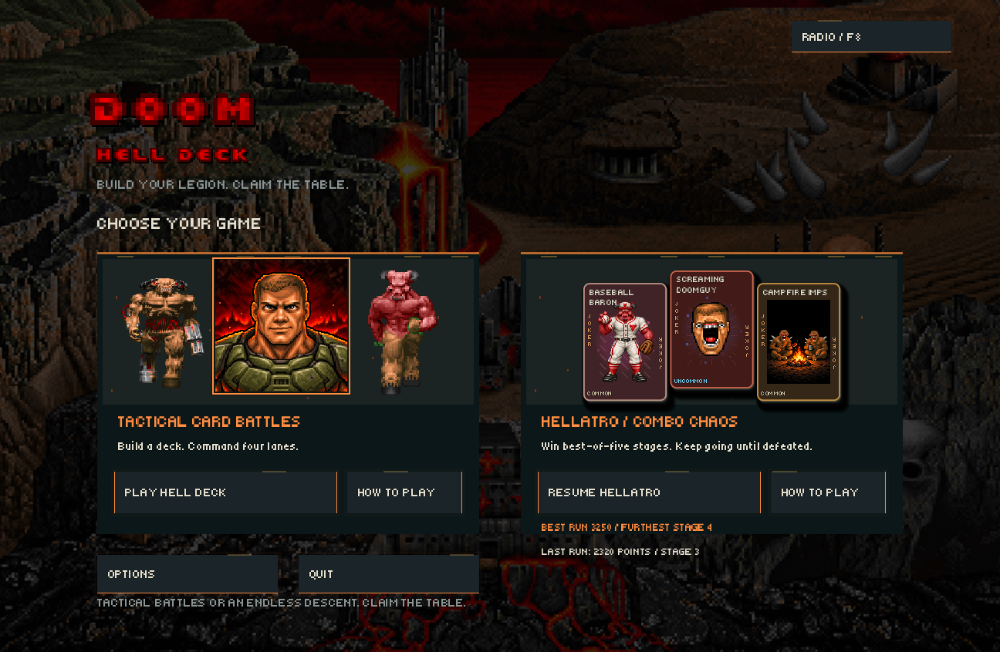
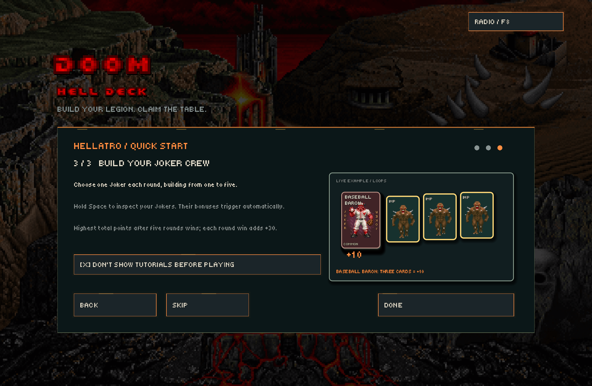
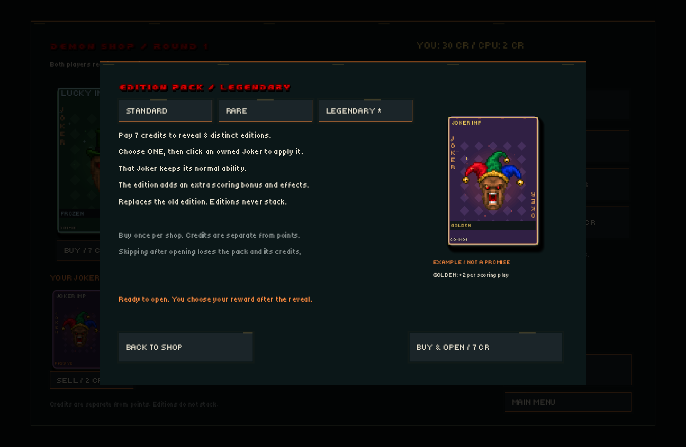
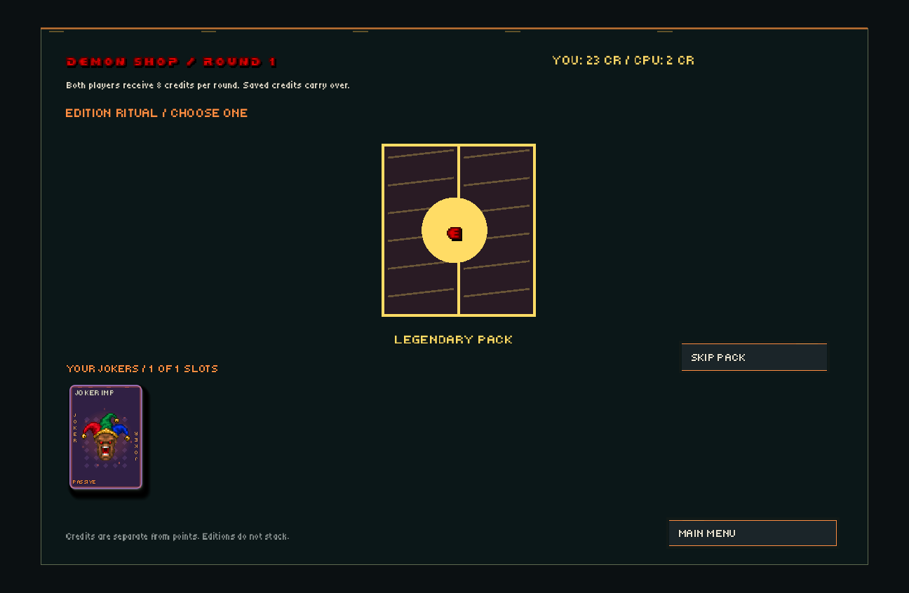
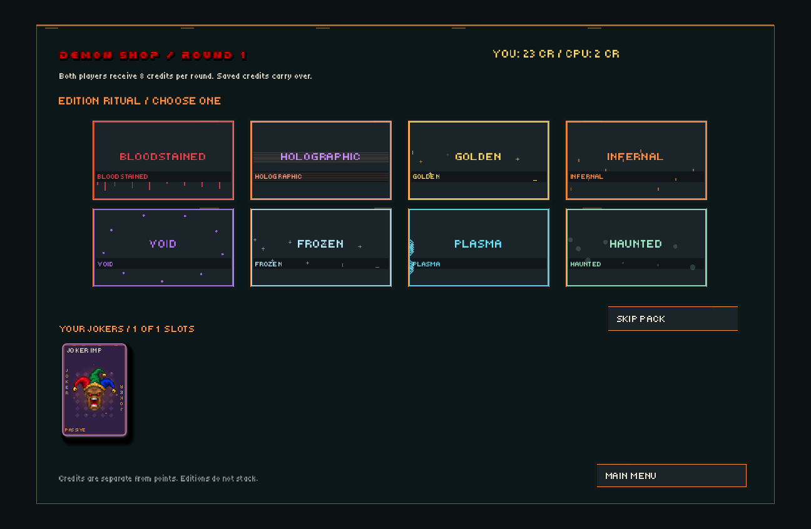
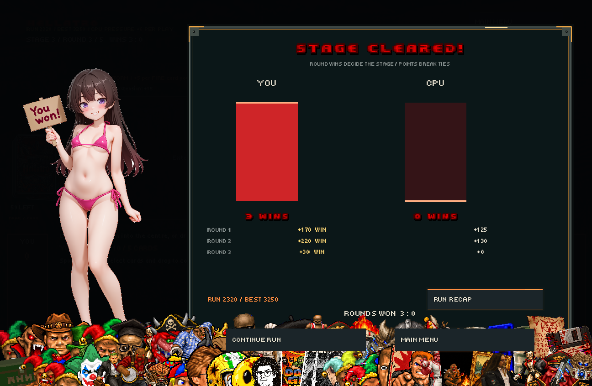
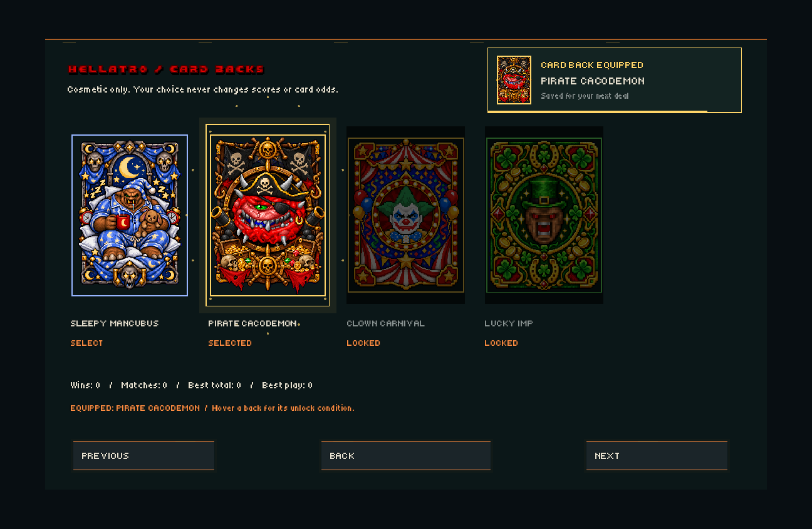

# DOOM: Hell Deck

A fan-made Godot 4 card game with two modes: **Hell Deck**, a four-lane tactical battler, and **Hellatro**, a competitive monster-combination game.

## Download

Get the Windows ZIP from [Releases](https://github.com/tuin-boop/DoomHellDeck/releases/latest), extract it, and run **DOOM-Hell-Deck.exe**. No Godot or .NET installation is required.

Provide your own **DOOM2.WAD** beside the EXE, or set `DOOM_WAD` to its location. The commercial IWAD is not included. The game also checks supported Steam installation paths.

## Quick start

Both modes offer short tutorials with looping visual examples. Skip them, disable automatic tutorials in Options or with “Don’t show again,” and reopen them with How to Play.





## Hellatro: Endless Run

Win best-of-five stages and continue with your build. **Round wins decide each stage**, with stage points breaking ties after five rounds. First to three wins ends a stage early; an exact tie replays it. Losing a stage ends the run. Points accumulate toward your run high score.

- **Save and resume:** quitting preserves hands, Jokers, credits, shop offers, paid pack choices and RNG state. Resume from the main menu.
- **50 Jokers:** draft up to five slots, combine animated editions and family upgrades, and watch scoring effects resolve one by one. Hover portraits to make them dance and read their exact rules.
- **Demon Shop:** both sides receive 8 credits each round. Buy and sell Jokers, reroll offers, or open booster packs. Credits and your build carry across stages.
- **Clear pack previews:** inspect cost, requirements and guarantees before purchase. Sealed packs shake, split and burst into staggered reward reveals.
- **Progression:** reach stage 2 for Rare packs and stage 4 for Legendary packs. These unlocks persist between runs.
- **Escalation:** CPU gains +3 per scoring play per extra stage. Both sides gain +2 per extra stage on extensions or plays of four or more cards. Boss rules apply every round from stage 3.
- **New combinations:** Crossfire at stage 2 (four distinct monsters, two of each of two damage types); Twin Trinity at stage 3 (two triples); Chaos March at stage 4 (four or more distinct ranks with one skipped rank).
- **Routes, mutations and relics:** choose a route between rounds to upgrade a combo family and preview upcoming conditions. The illustrated Field Guide explains patterns and rule-changing Jokers.
- **Run recap and records:** see strongest plays, Joker contributions, new unlocks, run score and personal best. Stage results show round-win bars so the display matches the winner.
- **11 cosmetic card backs:** select your back in Options, with an animated equipped notification. Includes supplied Scream King, Sleepy Mancubus, Pirate Cacodemon, Clown Carnival and Lucky Imp art, plus stage-earned colour variants.
- **Presentation:** sequential Joker scoring, animated round intros, gib bursts, confetti, win/loss art, Joker collage, final-turn alerts and configurable screen shake/gibs/reminders.

| Pack | Standard | Rare | Legendary |
| --- | --- | --- | --- |
| Joker | 4 CR: pick 1 of 3 weighted offers | 7 CR: 3 Uncommon/Rare offers | 10 CR: 3 Rare offers |
| Edition | 3 CR: pick 1 of 3 editions | 5 CR: pick 1 of 5 | 7 CR: pick 1 of all 8 |
| Upgrade | 3 CR: +5 to a family | 5 CR: +10 | 8 CR: +15 |

Legendary is the **pack tier**; the Joker rarity guarantee is Rare. Each pack type can be bought once per shop across tiers. Edition packs replace one owned Joker's edition while keeping its normal ability. Upgrade packs offer three families. Skipping an opened pack does not refund credits.



| Pack opening | Eight edition choices |
| --- | --- |
|  |  |





Screenshots show staged in-game examples. Result artwork includes stylized swimsuit illustrations.

## Hell Deck

Build decks, choose a commander, and fight across four lanes. Monsters have damage types, resistances, abilities, and squad synergies. Includes opening-hand redraws, guided deck building, optional side-view battles, and Daisy's Bunny Guard pairing with Doomguy.

| Deck building | Side-view combat |
| --- | --- |
|  |  |

## Controls

- **Hellatro:** select and drag cards to the centre, or use Play Selection. Draw / Pass ends your action and clears the centre.
- **Hold Space:** show your Joker tray; release to close it, with fast Doom door sounds. An animated reminder appears each round and can be disabled in Options. Hover the CPU tab to inspect its Jokers. Click two owned Joker slots to rearrange them.
- **Hell Deck:** drag cards into lanes, right-click a hand card for a squad, Space ends your turn.
- **F8:** Hell Radio. **Escape:** close a panel or open the menu.
- Optional Hellatro hints: type `johnromerogod`, then hover highlighted cards to see legal combinations.

## Run from source

Open `project.godot` in **Godot 4.7.2** and press **F5**. This is a GDScript project; no C# SDK is required. Supply your own WAD as above. For Windows exports, install matching Godot export templates and use **Windows Share**.

## Tests and balance

Create `captures` and `reports` directories before running tests from a clean clone:

```powershell
godot --path . --script scripts/support_jokers_test.gd -- --balance-test
```

The 50-Joker regression suite and 100-round legacy gameplay checks passed. New tests cover best-of-five stages, retained builds, game over, pack tiers, permanent unlocks, atomic save/resume and preserving paid pack choices. UI tests render pack previews, opening effects, eight-edition selections, run HUD, stage results and the resume menu.

Thirty seeded automated endless runs covered **188 rounds**, cleared 19 stages and reached stage 6 at best. Both bots used the same greedy move and standard-shop policy, with random player route choices and CPU pressure enabled. See [the current run report](reports/endless-simulation.json). This is a functional check, not a human difficulty estimate. Older balance reports describe historical rules.

```powershell
godot --headless --path . --script scripts/endless_run_test.gd -- --balance-test
godot --headless --path . --script scripts/endless_simulation_test.gd -- --balance-test
godot --path . --script scripts/endless_ui_test.gd -- --balance-test
```

## Credits

This is an unofficial fan project, not affiliated with id Software, Bethesda, Nintendo, or people depicted on cards. Third-party names, characters, sprites, music, and illustrations belong to their respective owners. No blanket open-source license is asserted for those assets.

Asset-specific source notes are retained under `assets/`. Joker and result illustrations were supplied for this project. Hell Radio includes synthesized Doom scores and selected Donkey Kong Country music. Commercial WAD files, local caches, and build tools are not included.

Voxel gib source and attribution: [NashGore voxel notes](assets/gibs/SOURCE.txt).
