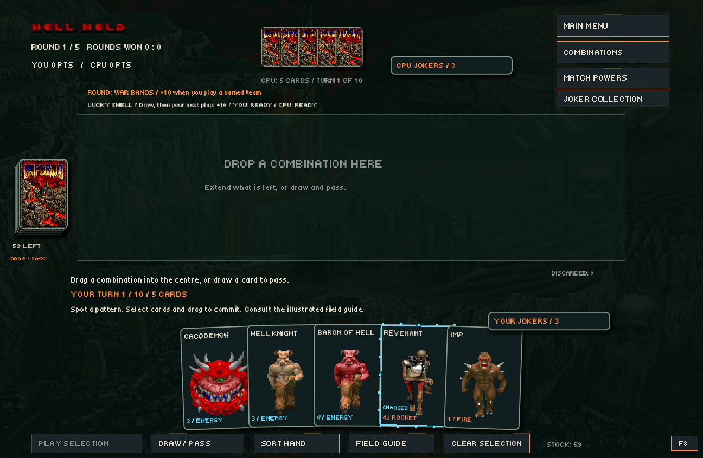
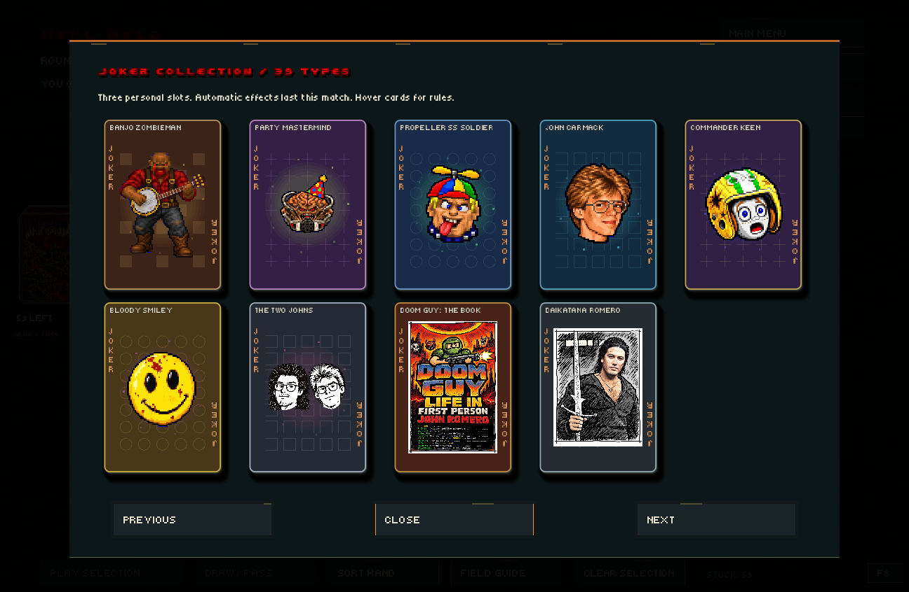
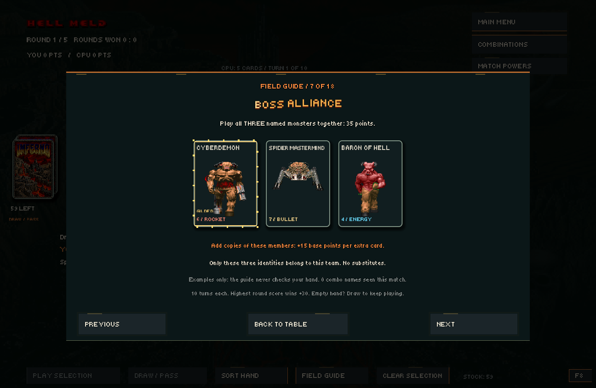
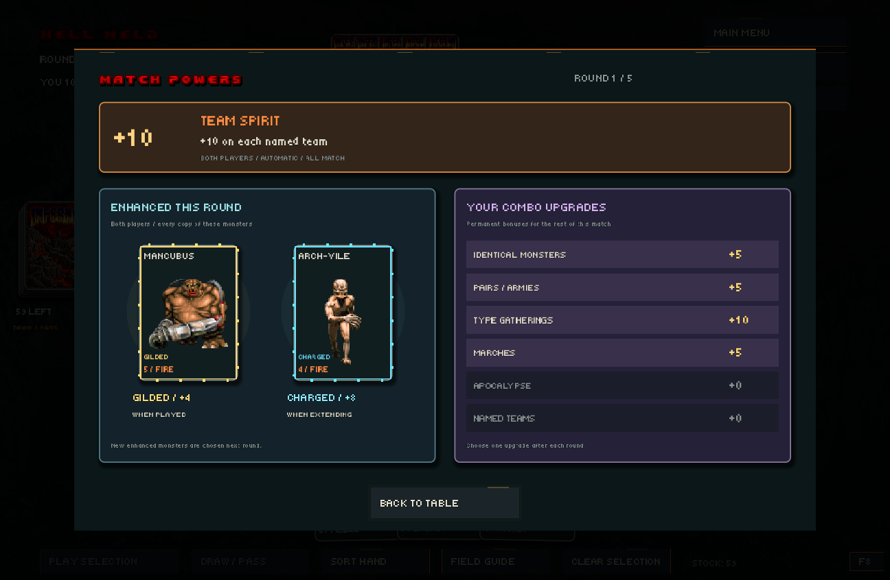
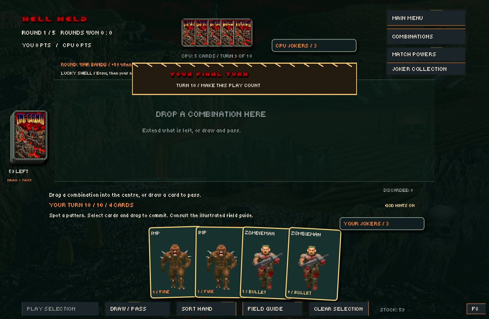
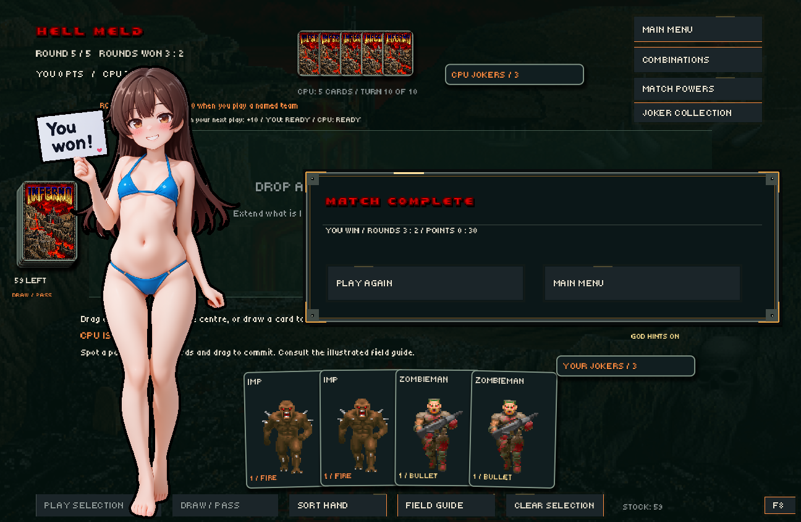
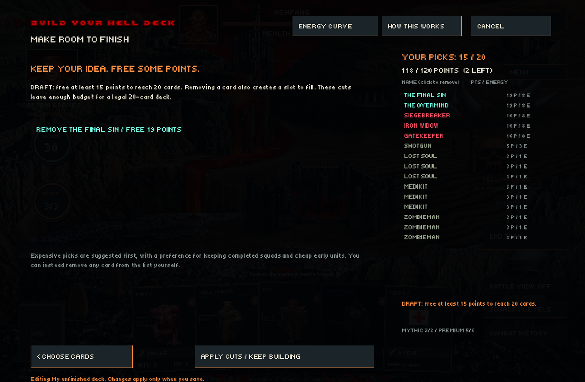
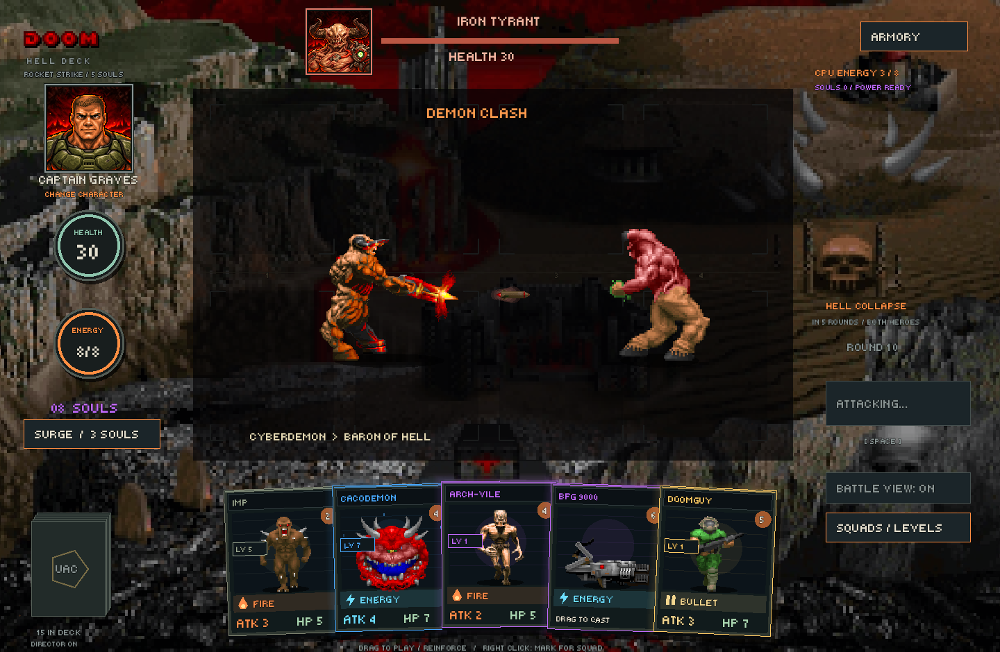

# DOOM: Hell Deck

A fan-made Godot 4 card game with two modes: **Hell Deck**, a four-lane tactical battler, and **Hell Meld**, a competitive monster-combination game.

## Download

Get the Windows ZIP from [Releases](https://github.com/tuin-boop/DoomHellDeck/releases/latest), extract it, and run **DOOM-Hell-Deck.exe**. No Godot or .NET installation is required.

Provide your own **DOOM2.WAD** beside the EXE, or set `DOOM_WAD` to its location. The commercial IWAD is not included. The game also checks supported Steam installation paths.

## Hell Meld

- Five rounds, ten turns each per round. Score more points to win rounds.
- Play matching sets, armies, damage-type groups, Marches, Apocalypse combos, and named teams.
- Extend the shared centre combination or draw/pass to clear it.
- Draft from **39 support Jokers**, with three active slots per player. Hover cards for effects and progress.
- Each scoring Joker appears in sequence with the points it contributes.
- Choose combo-family upgrades between rounds; inspect shared bonuses and enhanced monsters in Match Powers.
- Animated combo lettering, illustrated guide, clickable Named Teams links, final-turn alerts, and animated result artwork.





| Field Guide | Match Powers |
| --- | --- |
|  |  |

| Final-turn alert | Match result |
| --- | --- |
|  |  |

Screenshots show staged in-game examples. Result artwork includes stylized swimsuit illustrations.

## Hell Deck

Build decks, choose a commander, and fight across four lanes. Monsters have damage types, resistances, abilities, and squad synergies. Includes opening-hand redraws, guided deck building, optional side-view battles, and Daisy's Bunny Guard pairing with Doomguy.

| Deck building | Side-view combat |
| --- | --- |
|  |  |

## Controls

- **Hell Meld:** select and drag cards to the centre, or use Play Selection. Draw / Pass ends your action and clears the centre.
- Hover Joker tabs to open trays. Click two owned Joker slots to rearrange them.
- **Hell Deck:** drag cards into lanes, right-click a hand card for a squad, Space ends your turn.
- **F8:** Hell Radio. **Escape:** close a panel or open the menu.
- Optional Hell Meld hints: type `johnromerogod`, then hover highlighted cards to see legal combinations.

## Run from source

Open `project.godot` in **Godot 4.7.2** and press **F5**. This is a GDScript project; no C# SDK is required. Supply your own WAD as above. For Windows exports, install matching Godot export templates and use **Windows Share**.

## Tests and balance

Create `captures` and `reports` directories before running tests from a clean clone:

```powershell
godot --path . --script scripts/support_jokers_test.gd -- --balance-test
```

The tests cover Joker scoring, preview purity, growth, resets, drafting, and presentation. `scripts/joker_balance_test.gd` simulates 500 five-round matches using fixed builds and greedy AI. The retained report covers an earlier **35-Joker** roster, not all 39 current Jokers. Balance remains provisional; simulated build win rates are not individual-card or human-play guarantees.

## Credits

This is an unofficial fan project, not affiliated with id Software, Bethesda, Nintendo, or people depicted on cards. Third-party names, characters, sprites, music, and illustrations belong to their respective owners. No blanket open-source license is asserted for those assets.

Asset-specific source notes are retained under `assets/`. Joker and result illustrations were supplied for this project. Hell Radio includes synthesized Doom scores and selected Donkey Kong Country music. Commercial WAD files, local caches, and build tools are not included.
